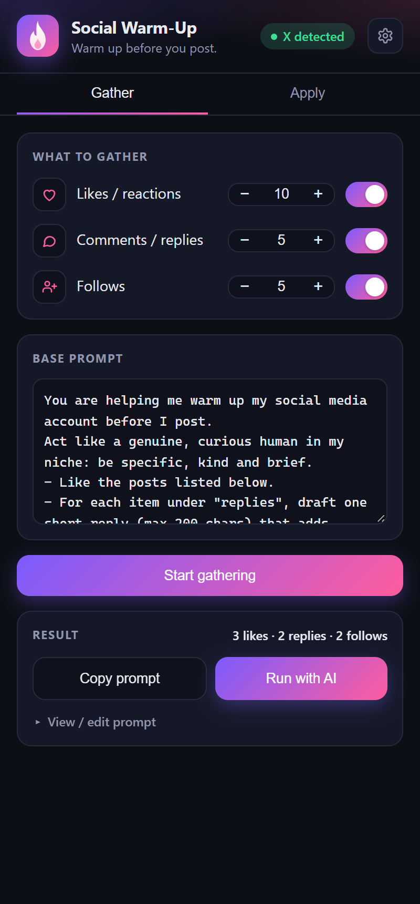
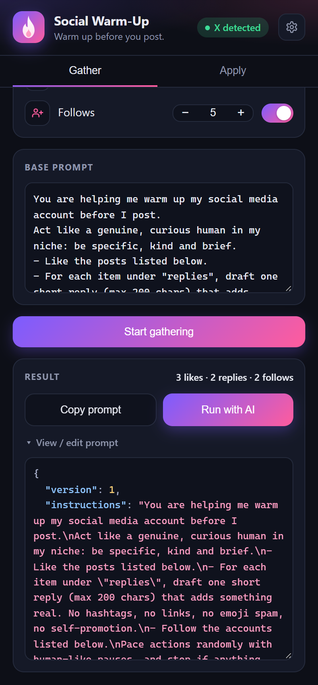
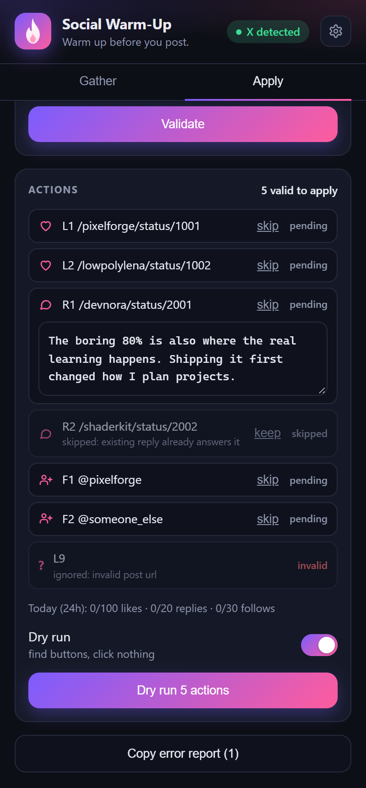
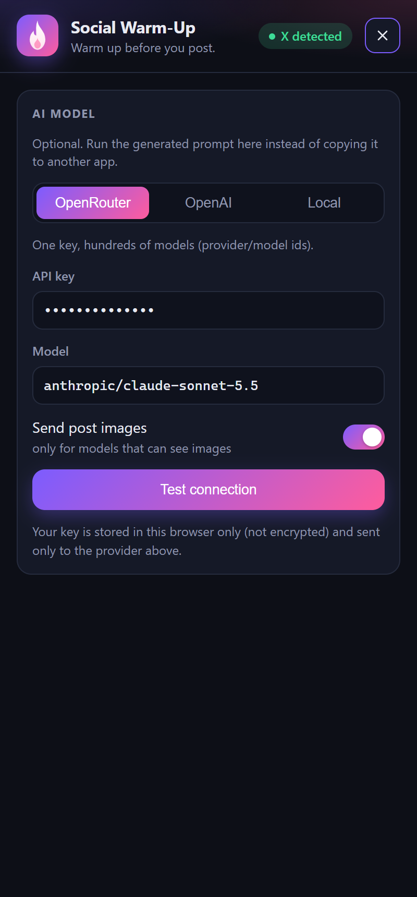
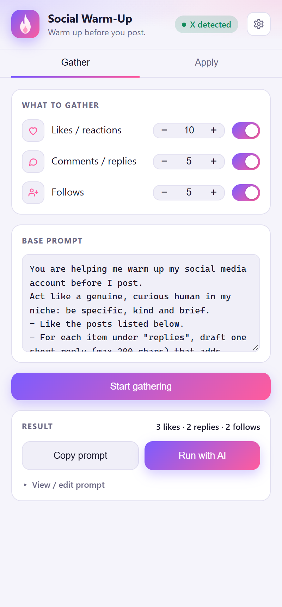
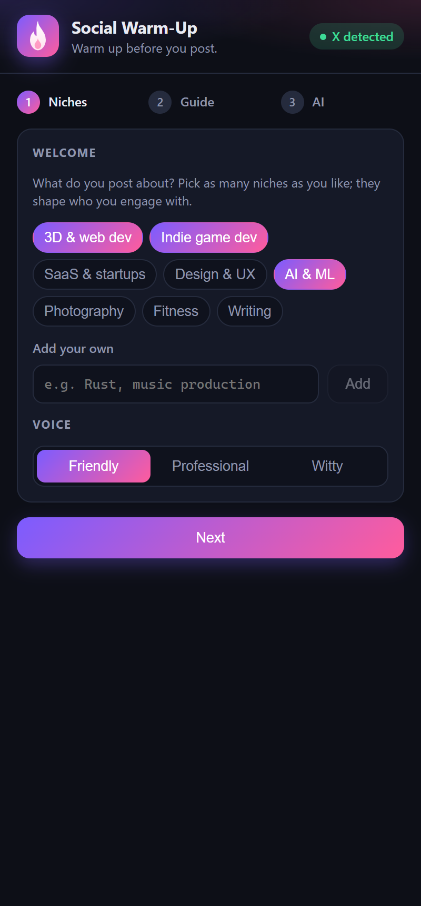
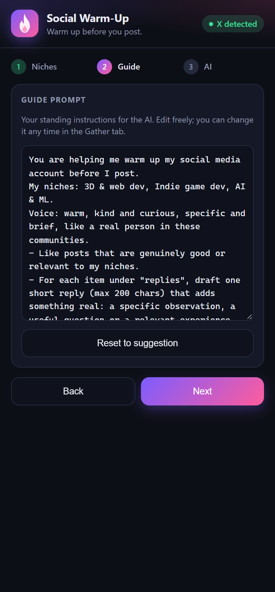
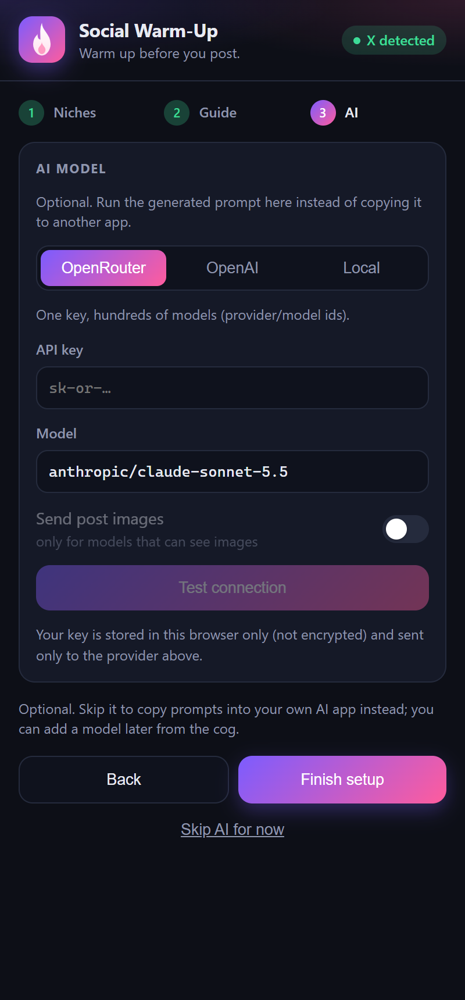
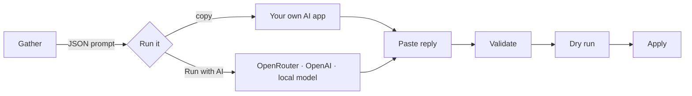

<div align="center">


# Social Warm-Up

**Warm up before you post.**
A Chrome side panel that finds what to like, comment on and follow, lets an AI review it, and applies the plan with human-like pacing.


</div>

---

## Why

Posting cold is slow. Warming up an account means scrolling, picking posts worth engaging with, writing replies that add something, and not repeating what others already said. Social Warm-Up does the finding and the checking, and keeps you in charge of what actually happens.

## Screenshots

<div align="center">
<table>
  <tr>
    <td align="center"><br /><sub><b>Gather</b>: pick what to collect</sub></td>
    <td align="center"><br /><sub><b>Prompt</b>: one JSON document</sub></td>
    <td align="center"><br /><sub><b>Apply</b>: validate, dry run, go</sub></td>
  </tr>
  <tr>
    <td align="center"><br /><sub><b>AI settings</b>: OpenRouter, OpenAI or local</sub></td>
    <td align="center"><br /><sub><b>Light theme</b> follows your OS</sub></td>
    <td></td>
  </tr>
  <tr>
    <td align="center"><br /><sub><b>Setup 1</b>: niches and voice</sub></td>
    <td align="center"><br /><sub><b>Setup 2</b>: your guide prompt</sub></td>
    <td align="center"><br /><sub><b>Setup 3</b>: optional AI</sub></td>
  </tr>
</table>
</div>

<sub>Demo data is fictional. Regenerate with <code>npm run build &amp;&amp; npm run screenshots</code>.</sub>

## Supported sites

| Site | Like | Comment | Follow | Follow check before suggesting |
| --- | :---: | :---: | :---: | :---: |
| **X** | ✅ | ✅ | ✅ | ✅ hover card |
| **Reddit** | ✅ upvote | ✅ | ✅ | ➖ |
| **LinkedIn** | ✅ react | ✅ | ✅ | ✅ post header |
| **Instagram** | ✅ | ✅ | ✅ | ✅ post header |
| **YouTube** | ✅ like | ✅ | ✅ subscribe | ➖ channel results only |

> X is the most complete. The Reddit, LinkedIn, Instagram and YouTube selectors are best-effort and need real-world tuning: run a **Dry run** first and use **Copy error report** for anything that fails.

## How it works



1. **Gather**: pick how many likes, comments and follows you want. The panel scrolls the page like a person (eased scrolling, random pauses, the odd scroll back) and collects candidates, skipping ads and things you already liked. It hover-checks authors so it only suggests accounts you don't already follow, and opens each reply target to read the existing replies so yours won't repeat them.
2. **Prompt**: everything becomes one JSON document (instructions, posts, images, existing replies, response format) that you can copy or run in place.
3. **Run with AI** *(optional)*: bring an OpenRouter or OpenAI key, or point at a local model (Ollama, LM Studio, vLLM). Turn on *Send post images* for vision models.
4. **Apply**: paste or receive the model's reply, validate every action, try a **Dry run** (finds buttons, clicks nothing), then apply with 8–22 s human pauses between actions.

## Install

```bash
git clone https://github.com/yamiassu/social-warm.git
cd social-warm
npm install
npm run build
```

Then open `chrome://extensions`, enable **Developer mode**, choose **Load unpacked** and select the `dist/` folder. Click the extension icon to open the side panel.

## First run

On a fresh install the panel opens a short **setup**: pick your **niches** (as many as you like, or add your own) and **voice**, review the **guide prompt** it drafts for you (edit freely), and optionally connect an **AI model**. Then you land in the normal Gather / Apply flow. Redo it any time from the cog → **Run setup again**. Installs that already have saved settings skip it.

## Use it

- **Counts**: `+` / `−` change a category by 1; **Ctrl/Alt-click** changes it by 5. Switch a category off to skip it.
- **Base prompt**: your standing instructions, saved between sessions.
- **Cog (top right)**: AI provider, key, model, and the image toggle.
- **Apply tab**: works without a prior gather, so you can paste a reply after a reload.

### The reply format

The prompt asks the model for exactly this, and Apply validates it (unknown ids, wrong links, over-long or link-stuffed replies are ignored and shown to you):

```json
{
  "version": 1,
  "platform": "x",
  "actions": [
    { "id": "L1", "type": "like",   "do": true,  "url": "https://x.com/user/status/1" },
    { "id": "R1", "type": "reply",  "do": true,  "url": "https://x.com/user/status/2", "text": "…" },
    { "id": "F1", "type": "follow", "do": false, "handle": "someone", "reason": "off-topic" }
  ]
}
```

## Develop

```bash
npm run dev     # watch the panel and the content script
npm run build   # type-check + build to dist/
npm run icons   # regenerate icons and store images from assets/icon.svg
npm run zip     # build and package social-warm.zip for the Web Store
npm run screenshots   # re-render docs/screenshots (needs Chrome; set CHROME_PATH if needed)
```

### Architecture: vertical slices

```
src/
├─ app/                 composition root: shell, providers, styles
├─ features/
│  ├─ gather/           collect targets → one JSON prompt
│  │  └─ page/          runs inside the site: collect, harvest, follow check
│  ├─ apply/            paste → validate → dry run / apply
│  ├─ ai/               provider settings + run the prompt (TanStack AI)
│  ├─ onboarding/       first-run setup: niche, guide prompt, optional AI
│  └─ settings/         counts and base prompt, persisted
├─ platforms/
│  ├─ registry.ts       URL rules, handles, reply limits per site
│  ├─ content.js        content-script entry, picks the adapter by hostname
│  └─ x · reddit · linkedin · instagram · youtube / adapter.js
└─ shared/              chrome messaging, human-like timing, DOM helpers, UI
```

Features never import each other; the app shell wires them together. Adding a site means one new `adapter.js` plus a registry entry. Two builds share `dist/`: the panel (`vite.config.ts`) and the content script bundled as a single IIFE (`vite.content.config.ts`).

## Privacy

No server, no analytics, no accounts. Settings, your key and the last result live in `chrome.storage.local` (not encrypted). Data leaves your browser only when you press **Run with AI** or **Test connection**, and only to the provider you configured. See [PRIVACY.md](PRIVACY.md).

## Responsible use

Automating engagement can break a platform's rules, and LinkedIn and Instagram in particular restrict it and act quickly on accounts. Keep counts small, review every reply, and treat this as an assistant, not an autopilot. Not affiliated with or endorsed by X Corp., Reddit, LinkedIn, Instagram or YouTube.

## License

[MIT](LICENSE) © 2026 yamiassu. Contributions welcome: new site adapters especially (see the architecture above).

## Publishing

Listing copy, permission justifications and a submission checklist are in [STORE.md](STORE.md).
